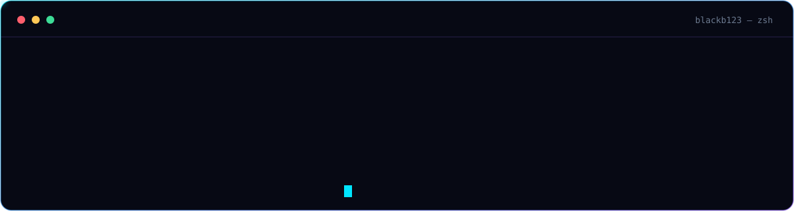
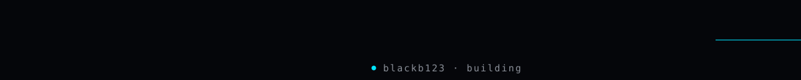

 

  

 

<b>Path</b> — click to expand

 

| Year | Where | What |
|---|---|---|
| 2025 | MNLV Media | Frontend developer on a web radio solution |
| 2024 | PEFSCOM SARL | Fullstack, desktop apps, databases, networking |
| 2023 | Chiala IT | IT support |
| 2020 | Self-taught | Python and Pygame, then C#, Unity, SQL, PHP, React |

<b>Currently</b> — click to expand

 

- Building interfaces with React, Vite, and Framer Motion
- Automating workflows with n8n and FastAPI
- Shipping faster with AI-assisted development
- Studying software engineering

  
    
  

 

  

<picture>
  <source media="(prefers-color-scheme: dark)" srcset="https://raw.githubusercontent.com/blackb123/blackb123/output/github-snake-dark.svg" />
  <source media="(prefers-color-scheme: light)" srcset="https://raw.githubusercontent.com/blackb123/blackb123/output/github-snake.svg" />
  
</picture>

 

Open to freelance work, collaborations, and interesting problems.

[**bradstudio.onrender.com**](https://bradstudio.onrender.com)

